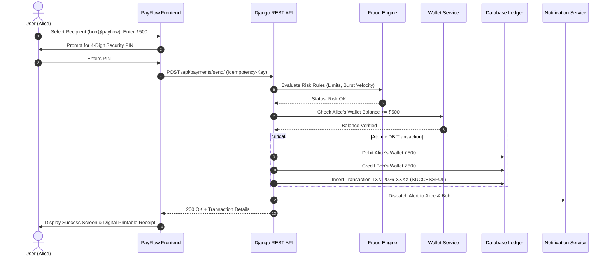
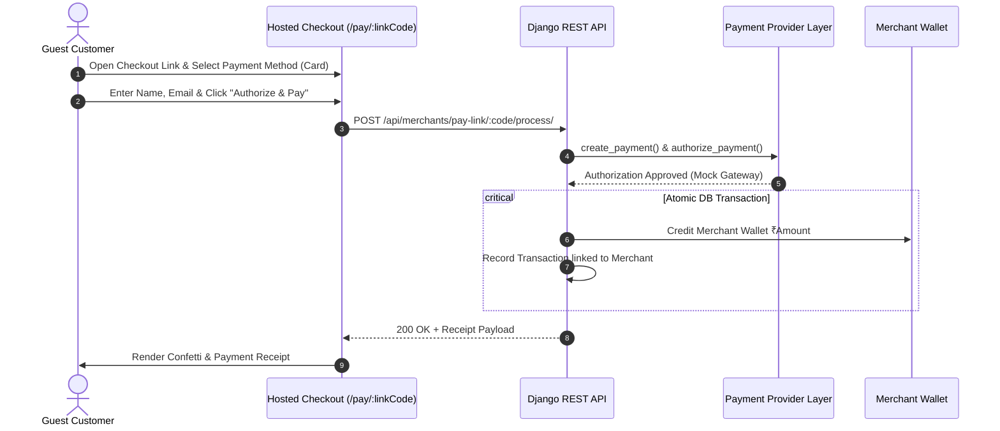

# PayFlow Payment Flow & Sequence Diagrams

## 1. End-to-End Payment Flow Diagram

```
User
 │
 ▼
Frontend (React 19 / TypeScript)
 │  - Validates form inputs & amount
 │  - Prompts for Security PIN modal
 │  - Generates unique Idempotency-Key
 │
 ▼
Django REST Framework API
 │
 ▼
Authentication & Permissions Layer
 │  - Validates Bearer JWT Access Token
 │  - Resolves Sender Account Context
 │
 ▼
Payment Service & Fraud Engine
 │  - Evaluates Fraud Rules (High amount / Rapid velocity)
 │  - Resolves Recipient (Email / Phone / UPI ID)
 │  - Verifies Wallet Balance / Token Validity
 │
 ▼
Payment Provider Abstraction Layer
 │  - Calls MockPaymentProvider.create_payment()
 │  - Calls MockPaymentProvider.authorize_payment()
 │  - (Or future Razorpay / Stripe adapter)
 │
 ▼
Atomic Ledger Committer (DB Transaction)
 │  - select_for_update() on sender & receiver wallets
 │  - Debits sender wallet
 │  - Credits receiver wallet
 │  - Inserts Transaction record (TXN-2026-XXXXXXXX)
 │
 ▼
In-App Notification Dispatcher
 │  - Notifies Sender: "Money Sent"
 │  - Notifies Receiver: "Money Received"
 │
 ▼
Receipt Generation Engine
    - Generates immutable digital receipt
    - Encodes verification QR payload
    - Client renders printable receipt & confetti celebration
```

---

## 2. P2P Send Money Sequence Diagram



---

## 3. Merchant Payment Link Sequence Diagram


